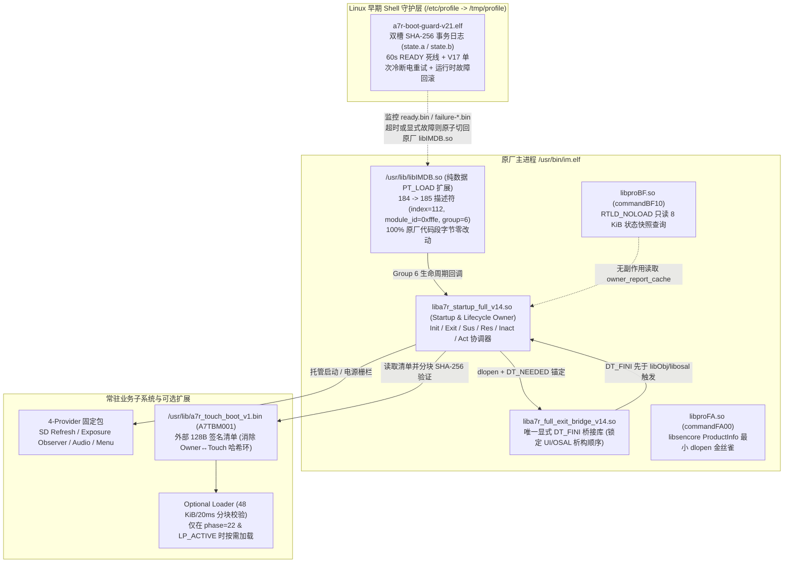
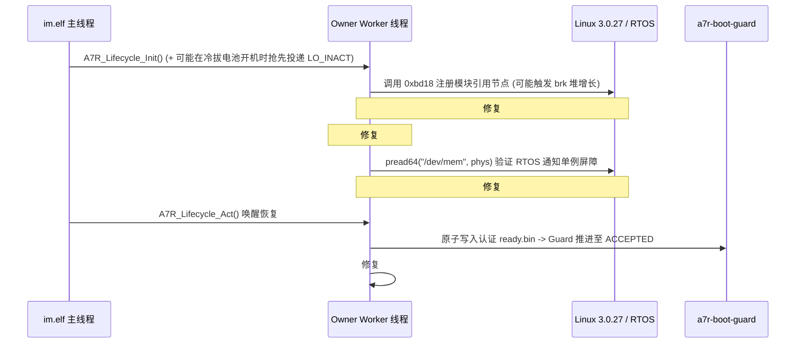

# `a7r3-boot-runtime` — 索尼 A7R III (FW 3.10) 模块注册扩展、双槽启动守护与事务化部署底座

> [!IMPORTANT]
> **零私有固件声明**：本仓库仅包含原创洁净室 C / POSIX Shell / Python 源码及宿主机离线测试，**不包含任何索尼受版权保护的固件镜像、ELF/DSO 二进制文件或内核/DSP 固件块**。任何基于实机解包目录的锚点校验与交叉编译均通过环境变量 `A7R3_FW_ROOT` 以只读方式在外部引用。

`a7r3-boot-runtime` 是面向 Sony Alpha 7R III (`ILCE-7RM3`, 固件版本 `3.10`) 的机内常驻运行时底座（Persistent On-Camera Runtime Foundation）。它在**零修改原厂可执行机器码**的前提下，打通了从开机早期守护、原厂 `im.elf` 生命周期模块注册、电源休眠/唤醒 (`INACT` / `ACT`) 屏障同步、无哈希环可选插件分块自加载，到进程退出 `DT_FINI` 顺序析构与带映射 inode 硬链保留原子安装的完整闭环。

---

## 免责声明

> 大家请以学习为目的使用本仓库⚠️⚠️⚠️⚠️，[安全研究法律边界与合规须知](./DISCLAIMER.md#法规与合规参考)
>
> 本仓库的所有内容仅供学习和参考之用，禁止用于商业用途。任何人或组织不得将本仓库的内容用于非法用途或侵犯他人合法权益。本仓库所涉及的固件分析、系统逆向与硬件接口研究技术仅用于个人合法自有设备上的学习与研究，不得用于未经授权侵入或破坏他人设备、绕过技术保护措施、提取或传播第三方专有固件或其他非法行为。对于因使用本仓库内容而引起的任何法律责任、硬件损坏（变砖）、数据丢失或保修失效，本仓库及作者不承担任何责任。使用本仓库的内容即表示您同意本免责声明的所有条款和条件。
>
> 点击查看更为详细的免责声明。[点击跳转](./DISCLAIMER.md)

---

## 技术路线与设计考量（与传统刷机改包方案的本质差异）

目前开源社区针对索尼相机固件的研究（如早期 `fwtool` 重打包、拆机焊接 UART/编程器，或近年针对新机型的自定义 `BODYDATA.DAT` 刷机包），主流做法是**直接静态修改内核镜像或原厂核心库（如 `appFw.so`）指令字节、替换签名公钥，再将修改后的固件烧录进内部闪存**。

本体系探索并验证了一条截然不同的工程路线：**零原厂代码段篡改（Zero-`.text`-Mutation）的外挂式模块化常驻 + 运行时内存/内核动态补丁（Runtime In-Memory Patching）+ 机内双槽自愈事务**。
> [!TIP]
> **本仓库在该路线中的角色**：承载**替代“整包刷写与硬件救砖”的机内自愈运行时底座**——以 `libIMDB.so` 纯数据段扩展（原厂代码段零字节改动）合法挂载自研模块，配合 `/tmp/profile` 早期 `a7r-boot-guard` 双槽事务日志（60s 未就绪自动回滚原厂）与 `nlink >= 1` 映射保留原子发布，实现纯软件免变砖闭环。

| 维度 | 传统/主流固件破解方案（静态改包 + 烧录硬件闪存） | 本体系路线（外挂动态加载 + 运行态内存/内核补丁） |
| :--- | :--- | :--- |
| **内核与原厂库修改方式** | 直接改写内核镜像（`uImage`）或原厂 `.so` 指令字节，替换 RSA 密钥后走升级脚本刷写 `nflash` 分区 | **内核分区镜像、RTOS 固件与原厂核心库的磁盘可执行代码段 100% 零字节改动** |
| **补丁生效机制** | **静态落盘固化**：靠刷写修改版固件覆盖原厂程序，以修改机型宏解锁同代已有隐藏分支为主 | **运行态动态干预**：仅对 `libIMDB.so` 追加纯数据描述符加载自研模块；在 RAM 中完成 GOT 替换、UI 回调桥接与动态 `insmod` 内核 `.ko` 探针（断电即净） |
| **防变砖与救砖手段** | 高度依赖拆机焊接主板微型 UART 串口，或使用外部硬件短接线强制拉入底层 `Fastboot` 救砖 | **纯软件自闭环防砖**：内置早期 `a7r-boot-guard` 双槽日志守护（60s 超时自动回滚原厂）+ `nlink >= 1` 映射保留原子替换，零硬件救砖口下零变砖 |
| **验证方式与开源洁净度** | 依赖静态反编译猜测 + 刷机试错；分发修改版固件包易触碰厂商专有代码版权红线 | **跨三核 Unicorn 原码无桩执行先验排雷**；仓库 **100% 为净室原创源码**，不携带、不分发一字节厂商专有固件 |

### 为什么要这样设计？（四大核心考量）

1. **单台主力机“零硬件救砖口”下的安全底线**：在不拆机焊串口、无底层 Fastboot 刷机线的真实条件下，直接改内核重刷闪存一旦出错即永久变砖。因此我们坚持**不重刷内核与固件大包、先建双槽自动回滚守护再上线功能、未闭合所有权的硬件异常一律执行失效关闭隔离（Fail-Closed Quarantine）**。
2. **彻底的净室（Clean-Room）开源合规**：不修改、不重打包原厂二进制，意味着开源仓库只需发布纯自研 C / ASM / Python 源码与构建脚本，从根源上规避专有固件分发风险。
3. **把试错成本消灭在接触硬件之前**：通过将原厂 ARM Linux、Thumb RTOS、MIPS32 协处理器机器码直接放入 Unicorn 无桩环境与 QEMU 原厂加载器靶场执行，在离线阶段即可精准捕获如 `ld-2.11.2.so` `DT_RELCOUNT` 覆写漏洞与传感器 8 位截断反例。
4. **突破“改宏开关”上限，从零构建原生子系统**：针对老架构原厂根本不存在的功能（无自定义音频导入、菜单触控事件位全零、回放无双指手势状态机），以分层插件底座赋予封闭固件真正的可扩展能力。

---

## 一、核心架构与模块拓扑



---

## 二、目录结构说明

| 目录 / 文件 | 核心职责与对应工程组件 |
|---|---|
| `imdb-registry/` | 纯数据 `libIMDB.so` `PT_LOAD` 扩展器 (`build_imdb.py`)。零外部依赖解析 ELF32，在 `group 7` 前插入 `module_id=0xfffe` (`group=6`)，保持 `.text`/`.plt`/`.rel.plt` 100% 原样且保证 `DT_REL + DT_RELSZ == DT_JMPREL`。 |
| `boot-guard/` | 独立双槽启动与运行时守护进程 (`a7r-boot-guard-v21.elf` + `/tmp/profile`) 及离线日志解码器 (`journal_decode.py`)，集成 **V17 窄化单次冷启动重试修复**。 |
| `startup-owner/` | 常驻启动与电源协调器 (`liba7r_startup_full_v14.so` + `libproBF.so`) 完整源码树，按职责划分为 `core/`、`platform/`、`bootstrap/`、`bundle/`、`barrier/`、`lifecycle/`、`autoload/` 与 `include/`。 |
| `exit-bridge/` | 进程级延迟析构桥 (`liba7r_full_exit_bridge_v14.so`)：栈中唯一携带 `DT_FINI` 的共享库，通过 `DT_NEEDED` 依赖链确保自定义线程在 Sony UI/OSAL 库卸载前安全排空并汇合。 |
| `publishers/` | 面向只读 `/usr` (`ext2`) 的原子事务发布器：`commit/` (`gi_run` 活跃映射 inode 硬链保留 + `renameat` + `MS_RDONLY` 重挂载)、`two-step-publish/`（两阶段核+封条发布器）与 `cleanup/`（零引用验证旧版本空间回收引擎）。 |
| `loader-canary/` | `libsencore.so` `ProductInfo` (`pfunc 0x10`) 进程内 `dlopen("/usr/lib/libproFA.so")` 最小无构造函数验证探针 (`commandFA00`)。 |
| `tests/` | 无需任何索尼固件二进制即可在宿主机运行的 Clang ASan/UBSan 与 Python 离线测试套件，以及可选的 `verify_firmware.py` 真机解包锚点与确定性交叉编译校验脚本。 |

---

## 三、四大关键实机故障修复与安全不变量

### 1. `ld-2.11.2.so` 非连续重定位表崩溃防护 (`DT_RELCOUNT = 0`)
索尼相机内置的旧版 `glibc ld-2.11.2.so` 在处理 `-Wl,-z,now` (`DT_BIND_NOW`) 且 `.rel.dyn` 与 `.rel.plt` 不连续的共享库时，会在第二段 (`DT_JMPREL`) 误重读 `DT_RELCOUNT` 并盲目按 `R_ARM_RELATIVE` 覆写 GOT 槽位，导致首次 PLT 调用立即 `SIGSEGV`。
- **不变量**：本仓库所有自定义 DSO 构建脚本在链接后强制将 `.dynamic` 中的 `DT_RELCOUNT` 归零，且 `imdb-registry/build_imdb.py` 严格验证 `DT_REL + DT_RELSZ == DT_JMPREL` 紧邻连续。

### 2. 已映射文件替换后的只读重挂载保护 (`nlink >= 1` 硬链保留)
Linux 内核 `fs_may_remount_ro` 在进程（如 `im.elf`）持有 `nlink == 0` 的已打开/已 `mmap` 删除态 inode 时，会拒绝将 `/usr` 重新挂载为 `MS_RDONLY` (`EBUSY`)。
- **不变量**：`publishers/commit/install.c` (`gi_run`) 与 `boot-guard/transaction.c` (`gx_run`) 在 `renameat()` 覆盖目标文件**之前**，必须先通过 `linkat()` 为当前活跃 inode 建立 `*.retained.so` 硬链接，保证替换后旧映射 inode 的 `st_nlink >= 1`，从而确保 `/usr` 100% 恢复 `MS_RDONLY`。

### 3. `startup-owner` 集成的四项核心实机修复


1. **修复 #1 — `0xbd18` 引用节点分配后刷新 `/proc/self/maps` (`error 11` 修复)**：`im.elf` 的 `0xbd18` 在创建 12 字节引用节点时可能通过 `brk` 扩展堆区，使新节点落在预缓存映射表之外；`startup-owner/core/native.c` 在持有双注册信号量期间立即执行一次 `np_check(&platform)` 安全刷新。
2. **修复 #2 — `/dev/mem` `pread64` 替代 `O_SYNC mmap2` (`error 37` 修复)**：内核 `phys_mem_access_prot` 将 `O_SYNC` 映射为 `writecombine`，导致读取刚初始化的 RTOS DRAM 单例时与缓存视图分叉；`startup-owner/barrier/policy.c` 改用单次 `pread64` (`syscall 180`) 走内核线性 `MT_MEMORY` 映射并细分 `warmup.c` 阶段错误码。
3. **修复 #3 — 拔电池冷启动早期 `LO_INACT` 接管与恢复 (`error 34` 修复)**：彻底断电重上电时，原厂可能在特性 `START` 前先投递 `LO_INACT`；`native.c` 与 `bootstrap_gate.c` 将其纳入受控暂停态包接管流程，待完整排空确认并收到原厂 `LO_ACT` 后通过 `native_inact_act` 路径发布 `READY`。
4. **修复 #4 — 外部 `A7TBM001` 签名清单与 48 KiB 分块可选自加载器**：通过外部 128 字节 `a7r_touch_boot_v1.bin` 解耦 Owner 与上层触控核心库之间的双向 SHA-256 死锁环，并在 `phase == 22 && LP_ACTIVE` 时以每步 48 KiB 有界分块哈希和 `RTLD_LOCAL` 加载，任何可选模块异常仅记录诊断而不触发底包回滚。

### 4. `boot-guard` V17 窄化单次断电启动重试 (`transaction.c`)
双槽事务日志 (`state.a` / `state.b`, 256B SHA-256 认证记录) 默认在发现上一轮非 `ACCEPTED` 时立即回滚原厂 `libIMDB.so`。为防止用户在开机中途拔电池导致已验收系统被误回滚，V17 仅在满足以下**全部苛刻条件**时允许**唯一一次**新开机重试：
- 两个日志槽均完整有效且序号严格相邻 (`latest.seq == previous.seq + 1`)；
- `previous.phase == ACCEPTED(code=0)` 且 `latest.phase == STARTED(code=0)`；
- `previous.boot`、`latest.boot` 与当前 `boot_id` 三者互不相同；
- 三个 `boot_id` 下均不存在任何 `failure-<boot>.bin` 或 `.new`（含损坏文件或符号链接）。
一旦进入该次重试，新写入的 `STARTED` 会自然覆盖旧的 `ACCEPTED` 槽，若再次中断则呈现 `STARTED / STARTED`，下一轮必定 fail-closed 自动回滚原厂。

---

## 四、快速测试与构建指南

### 1. 离线宿主机单元测试（无需索尼固件、无需交叉编译器）
仅需宿主机 `clang`（支持 AddressSanitizer / UndefinedBehaviorSanitizer）与标准库 `python3`：

```bash
make test
```

`make test` 会依次执行 8 组离线验证：
1. 合成 ARM32 `ET_DYN` ELF 的 `libIMDB.so` `184 -> 185` 表扩展、零代码修改与重定位连续性验证；
2. 256 字节双槽事务日志 (`A7GXST01`) 与守护观察记录 (`observer`) 解码器边界测试；
3. `libproFA.so` `commandFA00` 协议包长、魔数与 51 种畸形输入拒绝测试；
4. `boot-guard` V21 核心事务状态机的 35 场景并发篡改、I/O 故障注入与硬链保留测试；
5. `boot-guard` V17 窄化单次重试与 `fork`/`_exit` 模拟写半截断电的 35 场景测试；
6. 冷拔电池早期 `LO_INACT -> LO_ACT` 启动门控状态机测试（631 项断言）；
7. `A7TBM001` 清单与可选加载器 `optional_loader` 预算/撤销/重入状态机测试（3,400+ 项断言）；
8. 固定 inode `/usr` 空间清理引擎与 `exit-bridge` `dlopen` 后映射刷新加载器测试。

### 2. 基于本地只读解包固件的锚点与确定性构建验证（可选）
若本地已有合法提取的 A7R III `3.10` 文件系统目录（只读访问，绝不修改原目录），可运行：

```bash
A7R3_FW_ROOT=/path/to/verified-3.10/filesystems make verify-fw
```

该命令将校验原厂关键组件 SHA-256，对真实 `libIMDB.so` 在临时目录执行纯数据扩展并核对确定性摘要（`61,840 B`），并在检测到 `zig` 编译器时自动完成全套 ARMv7 静态守护进程、常驻 Owner、退出桥与原子发布器的交叉编译及无 `RWX` / `DT_RELCOUNT == 0` 审计。

### 3. 单独调用 `libIMDB.so` 纯数据扩展器

```bash
python3 imdb-registry/build_imdb.py \
  --stock-imdb /path/to/verified-3.10/filesystems/nflasha15/export/lib/libIMDB.so \
  --output /tmp/libIMDB.candidate.so \
  --report /tmp/imdb-report.json
```

### 4. 清理构建产物

```bash
make clean
```

---

## 五、许可证与免责声明

本项目基于 [MIT License](LICENSE) 开源。请仔细阅读 `LICENSE` 中的商标声明与硬件安全风险提示：在未完成完整逻辑 NAND 备份并充分理解双槽回滚机制前，请勿在实机上执行任何写入操作。
